<h1 align="center">🌲 Timber Tycoon</h1>

<p align="center">
  <b>An isometric lumber-factory idle game for your browser and phone.</b><br>
  Chop logs, build a sawmill, and grow it into a three-phase timber empire with belts, drones, clients and research.
</p>

<p align="center">
  <a href="https://semihkislar.github.io/timber-tycoon/"><b>▶&nbsp;&nbsp;Play now</b></a>
  &nbsp;·&nbsp;
  <a href="https://semihkislar.github.io/timber-tycoon/versions.html">All versions</a>
  &nbsp;·&nbsp;
  <a href="CHANGELOG.md">Changelog</a>
</p>

<p align="center">
  
  
  
</p>

<p align="center">
  <a href="https://semihkislar.github.io/timber-tycoon/">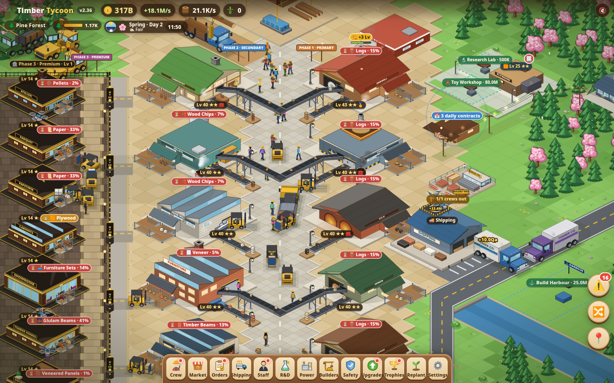</a>
</p>

No download or account needed. It runs in any modern browser, plays well on phones, and can be installed as an app
(PWA). Your progress is saved in the browser, and your crews keep working while you are away.

---

## ✨ Highlights

### New in v2.38: First steps for new players
A brand-new game now opens with a short **First steps** guide: a small card and a 👆 pointer on the scene that walk you
through the first minutes:
1. 🪓 tap the forest to chop logs,
2. 🧔 hire your first Lumberjack (free),
3. 🪚 build the Sawmill with 40 logs,
4. 🪙 earn your first coins,
5. ⬆️ upgrade the Sawmill,
6. 📋 take your first client order.

The button to press gets a gold ring, and the card keeps clear of the bottom sheets, the order card and the side buttons on
desktop and phones. **Skip ✕** hides it, and **Settings → 📘 Replay** brings it back. It gives nothing for free, so the early
game plays exactly as before. Existing saves never see it unless you ask.

<p align="center"></p>

### Recent releases
| Version | Feature | What it does |
|---|---|---|
| **v2.37** | 📦 **Seasonal export contracts** | Every season brings one themed export contract (spring houses and glulam, summer boats and toys, autumn furniture, winter pellets and charcoal). It is sized on your output, pays 1.5–2.5× plus a 20 % seasonal premium, and has a trophy for each season. |
| **v2.36** | 🧰 **Workstation sets** | Level all three workstations of a building together: Lv 5 gives 🧰 Tuned Line (×1.10 speed), Lv 10 gives 🏅 Master Set (×1.25 speed and the manager's skill doubled, within its caps). |
| **v2.35** | 📐 **Replant Blueprints** | Save your factory as a plan: target levels, priorities, crew, upgrades, logistics and settings. After a Replant, a planning office rebuilds it with real coins at normal prices. You choose its budget (25 / 50 / 100 %) and can pause it any time. It is unlocked by research and has up to three plan slots (A/B/C). |
| **v2.34** | 🔗 **Order chains** | Clients bring three-step projects, such as the Royal Embassy library: archive paper → reading-room chairs → library cabinets. Each delivery unlocks a bigger step, and finishing all three pays a **30 % chain bonus**. |
| **v2.33** | 🪞 **Veneer & Decor line** | The Veneer Panel Press (Phase 2) and the Decor Studio (Phase 3) turn spare veneer into veneered panels and decor furniture. They use only stock that no other line needs. |
| **v2.30–2.32** | 🚜 **Logistics tiers** | **Forklift Depot** with calm forklifts (tier 1), **conveyor belts** across the lane (tier 2) and a **Drone Port** on the dock roof (tier 3). Each tier boosts output from the same inputs. |

### The core game
- 🏭 **Isometric production chain.** 6 kinds of collectors bring in logs for 22 buildings making 24 goods: planks, chips,
  veneer, plywood, glulam beams, furniture, timber-frame houses and more. Watch trucks, forklifts and workers move every
  good across the yard.
- 🪜 **Three factory phases.** Phase 1 turns logs into raw materials, Phase 2 processes them, and the Phase 3 Premium Row
  builds luxury goods. Logs are raw material only, so value comes from processing.
- 🛠️ **Leveled upgrades and workstations** with milestone gates, plus **line specialisations** (⚡ High-speed, ♻️ Lean,
  💎 Master craft) from Lv 50.
- 🔬 **Research 2.0.** A 67-node tree in 5 branches and 5 tiers, fuelled by paper in the Research Lab. Repeatable nodes keep the
  late game going.
- 👷 **Staff and managers.** Hire, train and assign staff with roles and wages. Named managers bring skills, and your staff
  walk and work in the world.
- 🌱 **Replant (prestige).** Restart the forest for Forest Legacy, then spend it in the Seed Shop and chase run goals. Costs
  scale with forest value, so every run stays meaningful.
- 📋 **Clients and contracts.** A client order board, three-step client projects, daily contracts, seasonal export
  contracts, export contracts at the Shipping Yard, and a trade map with a harbour and rail.
- ⚡ **Biomass power plant**, a 🚒 **fire station**, 🏗️ **Builders' Yard** crews that auto-upgrade, and a 🌳 planting crew
  that keeps the forest stocked.
- ⛈️ **Setbacks and insurance.** Occasional storms, floods, thefts, breakdowns and audits, capped small and fair, with
  repairs, insurance and safety upgrades as counter-play. Setbacks only happen while you play.
- 🌗 **Day–night cycle, four seasons and weather**, each with gameplay effects. Windows light up at night, and trucks drive
  with headlights.
- 🔀 **Supply Flow view.** Isometric producer → consumer arcs with rates and colour-coded health.
- 🏆 **Trophies** for milestones and every factory system.
- 📱 **Mobile-first.** Touch camera with momentum, pinch and double-tap. Draggable sheets, a needs-attention list, hold-to-buy,
  landscape mode and haptics. Installable as an app.

## 🖼️ Gallery

| | | |
|:---:|:---:|:---:|
| 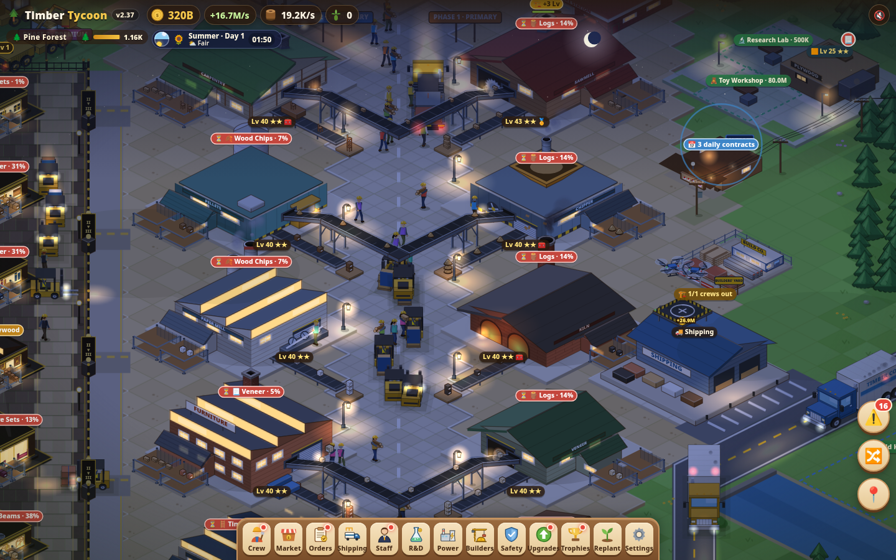<br>**Night shift** | 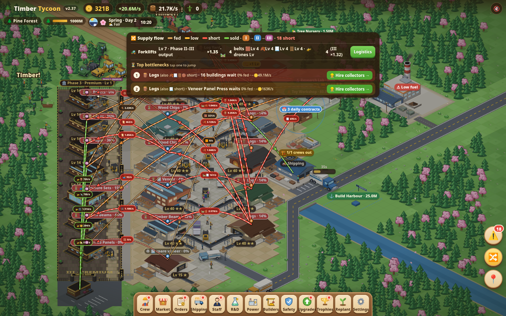<br>**Supply Flow + Advisor** | 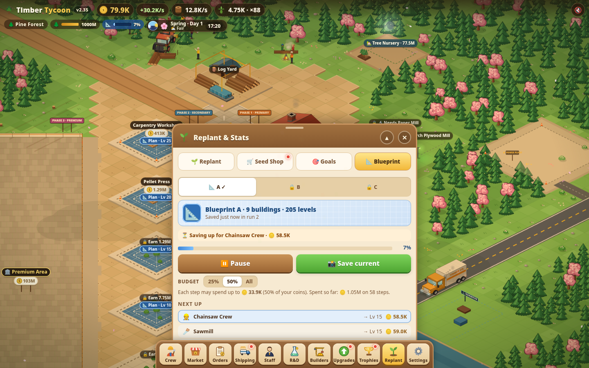<br>**Replant Blueprints** |
| 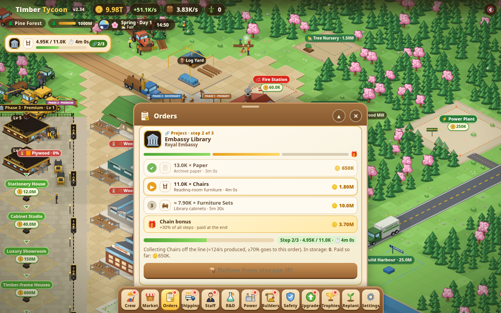<br>**Order chains** | 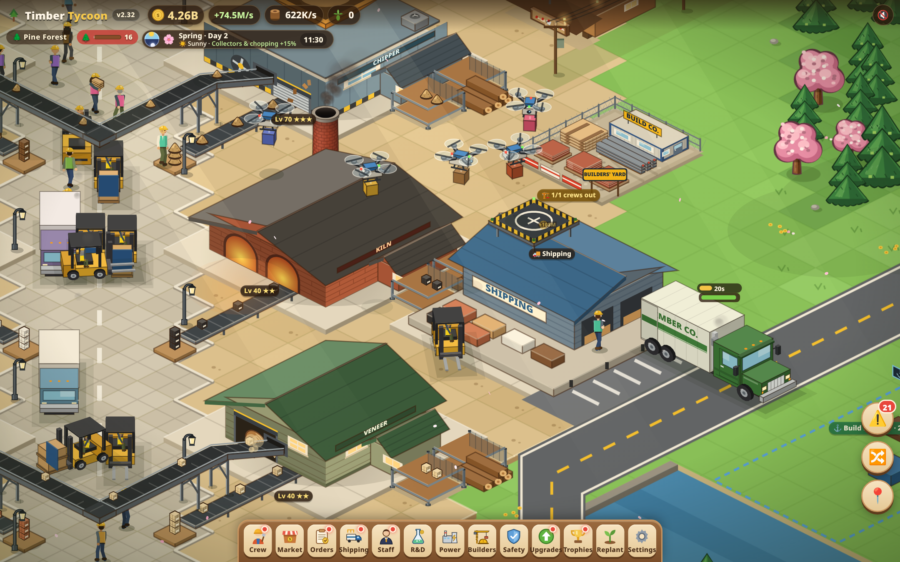<br>**Drone Port** | 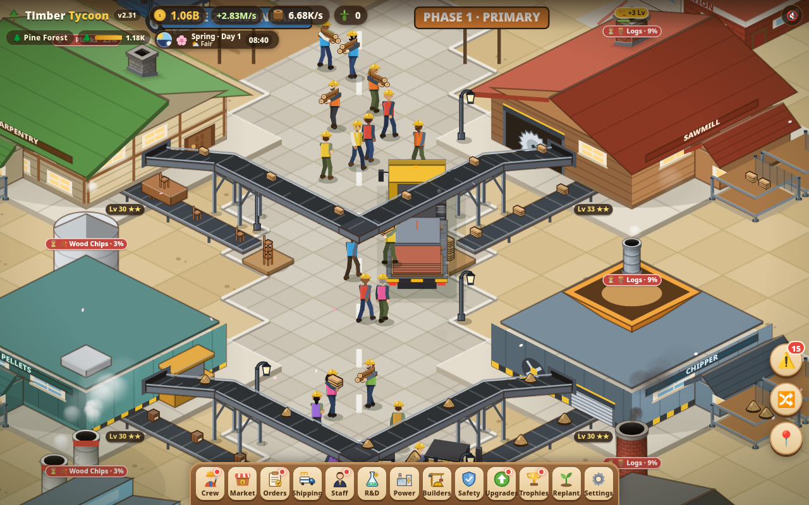<br>**Conveyor belts** |

**On a phone (iPhone 13):**

| | | | | |
|:---:|:---:|:---:|:---:|:---:|
| 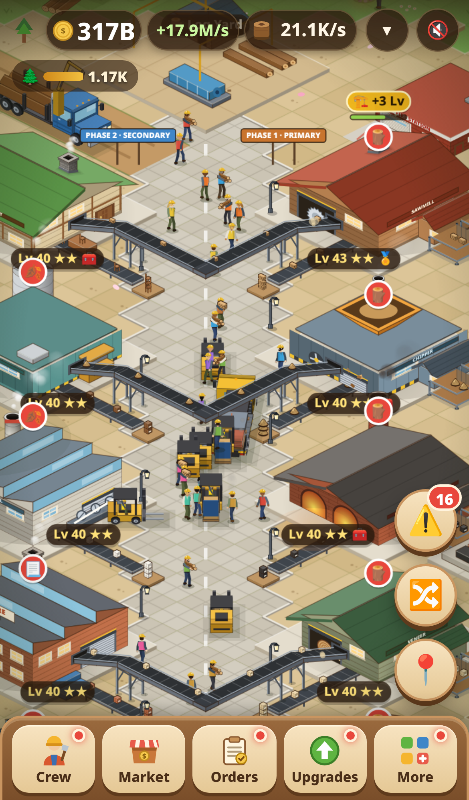<br>Factory | <br>First steps | 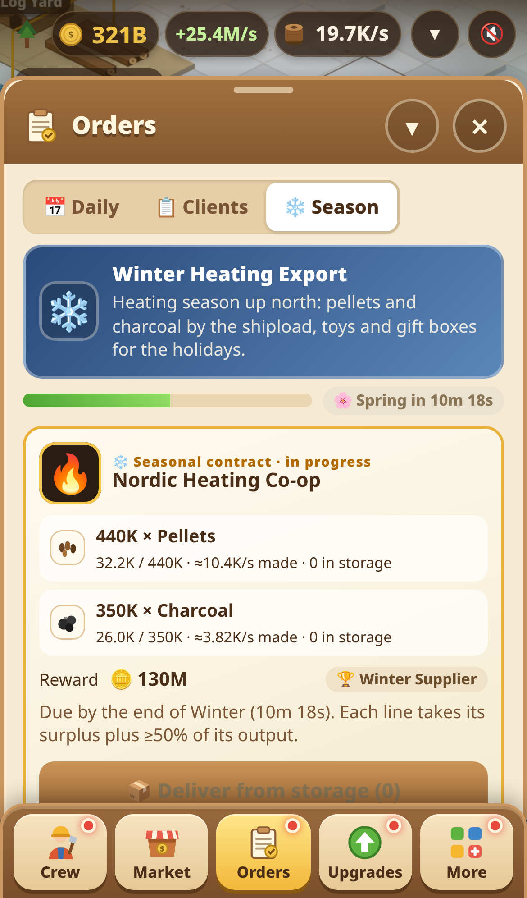<br>Seasonal contract | 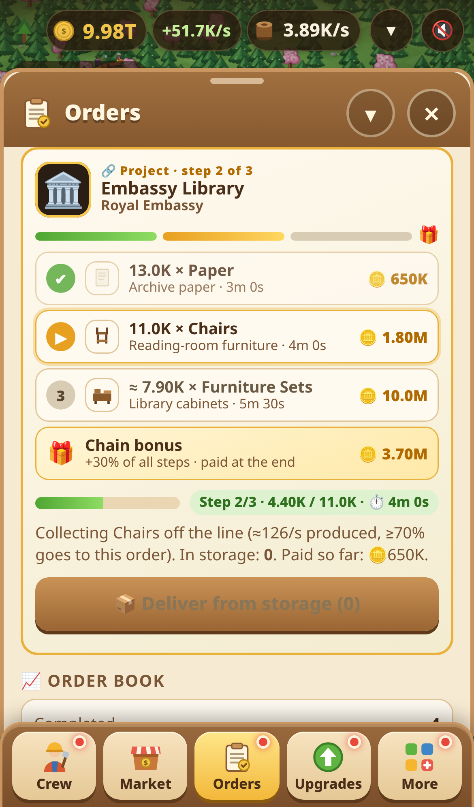<br>Order chains | 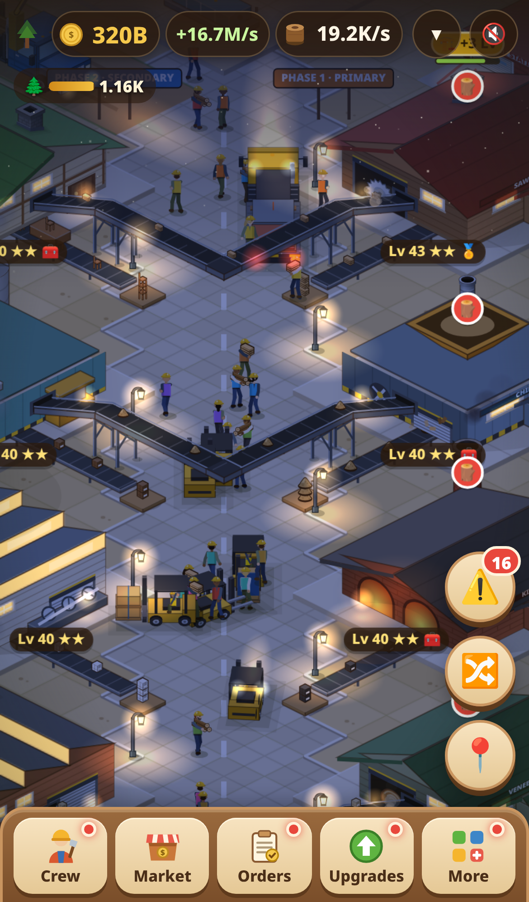<br>Night |

Screenshots from every release are in [`screenshots/history/`](screenshots/history/).

## 🎮 How to play
1. **Tap the trees** to chop your first logs, then hire **Lumberjacks**. Logs flow into the Log Yard by themselves.
   New games show a short **First steps** guide for this (replay it in ⚙️ Settings).
2. **Build a Sawmill** and the next buildings in the chain. Turn on **auto-sell** for goods you don't process further.
3. **Upgrade** buildings, buy **workstations** and **upgrades**, and hire **staff** and **managers** to speed up each line.
4. When a building waits on an input, follow the **Advisor's** hint or open **Supply Flow** (🔀) to find the bottleneck.
5. Take **client orders**, **projects**, **daily** and **seasonal contracts** for big rewards. Open Phase 2, then the Premium Row.
6. When growth slows, **Replant** for Forest Legacy, buy Seed Shop perks, and come back faster. A **Blueprint** rebuilds
   your layout for you.

**Controls:** drag to pan, scroll or pinch to zoom, double-tap to zoom in, tap a building to open its card. On desktop:
arrow keys pan, <kbd>+</kbd>/<kbd>−</kbd> zoom, <kbd>F</kbd> toggles Supply Flow, <kbd>Esc</kbd> closes a sheet.

## 💻 Run locally
The game is a static site with no build step and no dependencies.

```bash
git clone https://github.com/semihkislar/timber-tycoon.git
cd timber-tycoon
python3 -m http.server 8000
# open http://localhost:8000/
```

It needs `http://`, not `file://`, because the sprite atlas is fetched. Tests use Python + Playwright
(`pip install playwright && playwright install chromium`), for example `python3 test/v238.py`.

## 🗂️ Project structure
```
index.html             game shell (markup + ordered <script> list)
css/style.css          styles
js/                    game code: classic scripts sharing one global scope (order = index.html)
assets/                sprite atlases and PWA icons
manifest.webmanifest   PWA manifest      sw.js  service worker (network-first)
releases/vX.Y/         playable snapshot of every release (see versions.html)
docs/                  design notes and DEVELOPMENT.md (code map, workflow, conventions)
test/                  Playwright suites and screenshot scripts
tools/                 release, asset, icon and profiling scripts
screenshots/           highlights/ (README images) and history/vX.Y/ (per-release shots)
lumber-idle.html       redirect for the old single-file URL
```

For the code map, tests and the release workflow, see **[docs/DEVELOPMENT.md](docs/DEVELOPMENT.md)**.

## 📜 History
Timber Tycoon has shipped a new version almost every day since v1.0 (Oct 6, 2026).
- **[CHANGELOG.md](CHANGELOG.md):** every change, version by version.
- **[versions.html](https://semihkislar.github.io/timber-tycoon/versions.html):** play any past release in your browser.
